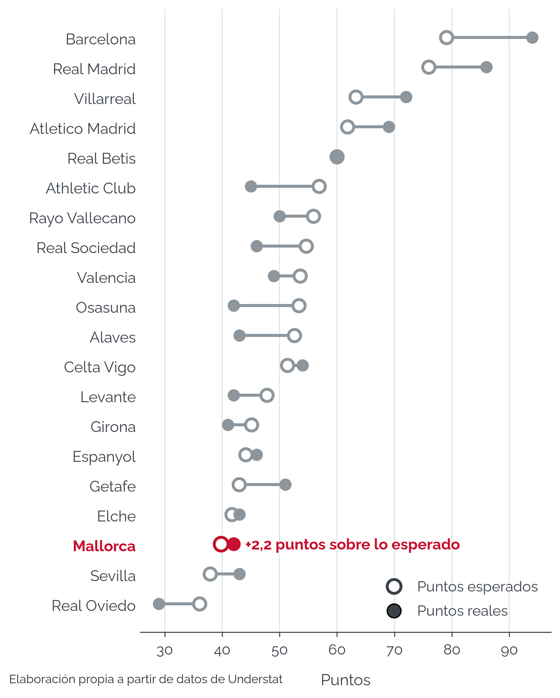
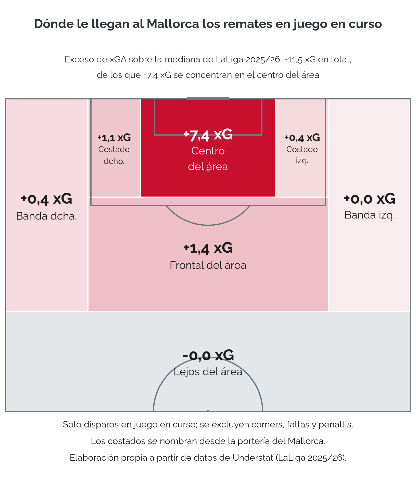
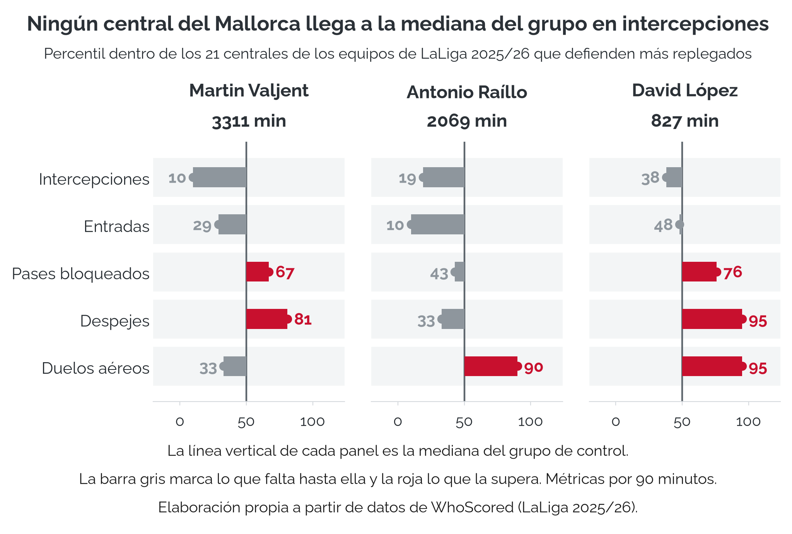
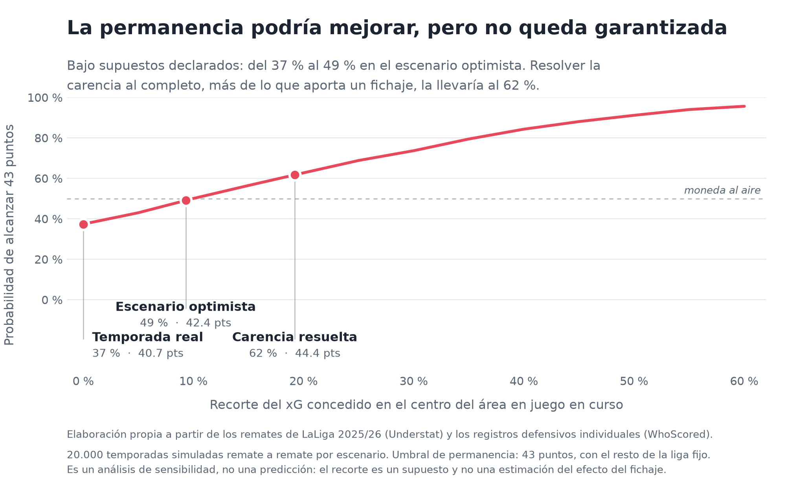

# Por qué descendió el RCD Mallorca

**Stack:** Python · pandas · scikit-learn · matplotlib · mplsoccer · soccerdata

Análisis con datos del descenso del RCD Mallorca en LaLiga 2025/26, identificación de la
carencia estructural que lo explica y propuesta de un refuerzo que la corrige.

Trabajo de Fin de Máster del Máster en Big Data e Inteligencia Artificial en el Deporte
(Unisport Management School).

| Hallazgo | Cifra |
|---|---|
| El descenso no fue mala suerte | 39,79 puntos esperados, decimoctavo de veinte, sumando 42 reales |
| El problema estaba en el centro de su área | +7,4 goles esperados de más, el 64 % del desfase en juego en curso |
| Ninguno de sus centrales anticipaba | Percentiles 10, 19 y 38 en intercepciones frente a 21 centrales de control |
| La criba deja ocho candidatos | 65 centrales, 33 en el rango de minutos, 8 pasan los cuatro criterios |
| El refuerzo podría mejorar la permanencia, sin garantizarla | Diego Llorente, 2,06 intercepciones por 90; en el escenario optimista, del 37,4 % al 49,1 % |

---

## El caso

El Mallorca bajó a Segunda con el **segundo máximo goleador de la competición** (Muriqi, 23
goles), 47 goles de equipo (noveno más goleador) y 42 puntos, los mismos que Levante y
Osasuna. Descendió por el triple empate: sacó 3 de los 12 puntos que se jugaba contra esos
dos rivales.

La pregunta es si fue un accidente o si el equipo jugó como un descendido.

## La respuesta, en tres pasos

**1. No fue mala suerte.** El Mallorca sumó 39,79 puntos esperados, decimoctavo de veinte.
Terminó con 42, es decir **2,21 puntos por encima de lo que su juego merecía**.



**2. El problema estaba en el centro de su propia área.** De los 11,5 goles esperados que
concedía de más en juego en curso, **7,4 se generaban desde el centro del área: el 64 % de
todo su desfase**. A balón parado concedía como un equipo medio.



**3. Ninguno de sus centrales anticipaba.** Frente al grupo de control (los 21 centrales de
los seis equipos que defendían igual de bajo), los tres centrales habituales quedan en los
**percentiles 10, 19 y 38 en intercepciones**, y los tres por encima en despejes y duelos
aéreos: reaccionan en lugar de anticipar.



Defender bajo no lo explica: la mediana del grupo de control es 0,96 intercepciones por 90
frente a 1,06 de toda la liga, solo un 9 % menos, y la correlación entre altura defensiva e
intercepciones es de 0,108.

## La propuesta

Criterios fijados **antes** de mirar ningún nombre: central, entre 400 y 1.800 minutos (rol
de rotación, accesible para el presupuesto), y por encima de la mediana de los 65 centrales
de LaLiga en intercepciones (1,06) y en entradas (1,58) por 90 minutos.

De 65 centrales, 33 cumplen el rango de minutos y **8 superan los cuatro criterios**.

**Diego Llorente** (Real Betis): 2,06 intercepciones por 90, percentil 98 de la liga y el
triple que Valjent, manteniendo 4,07 duelos aéreos ganados. Aporta lo que faltaba sin
quitar lo que había.

## Qué no dice este trabajo

Dos resultados negativos que delimitan el alcance, y que están documentados en lugar de
escondidos:

- **El modelo supervisado no predice.** Un árbol de decisión acierta el 52,3 % y un bosque
  aleatorio el 49,2 %, frente al 53,8 % del clasificador trivial. Los registros defensivos
  individuales de un central no permiten anticipar cuánto xG concede su equipo.
- **El efecto del fichaje no es estimable.** Una regresión sobre los veinte equipos da un
  R² de 0,040 con p-valor de 0,397.

Por eso el notebook 06 es un análisis de sensibilidad y no una predicción: calcula cuánto
habría hecho falta recortar, no cuánto habría recortado Llorente. Simulando la temporada
remate a remate, 20.000 veces por escenario, ni resolviendo la carencia al completo el
Mallorca se salvaba con seguridad.



## Estructura

```
notebooks/
  01_descarga_datos.ipynb            Descarga y limpieza de las cuatro fuentes
  02_analisis_equipo.ipynb           Diagnóstico colectivo: xPTS, zonas, estilo
  03_analisis_jugadores.ipynb        Percentiles por puesto y fichero maestro de métricas
  04_scouting.ipynb                  Modelo, perfiles, criba y finalistas
  05_visualizaciones.ipynb           Las siete figuras, en versión clara y oscura
  06_simulacion_contrafactual.ipynb  Simulación de la temporada y análisis de sensibilidad
data/                                Ficheros generados; solo se versiona el de posiciones
images/                              Figuras en PNG
```

Los notebooks se ejecutan en orden y de arriba abajo. Cada uno declara al principio qué
ficheros lee y cuáles genera.

## Datos

| Fuente | Qué aporta |
|---|---|
| [Understat](https://understat.com) | 380 partidos y 9.523 remates con su xG |
| [FBref](https://fbref.com) | Estadísticas individuales de la competición |
| [WhoScored](https://whoscored.com) | 577.205 eventos Opta con coordenadas y alineaciones |
| Elaboración propia | Posición real de los 637 jugadores de campo |

Las tres fuentes públicas se descargan con [soccerdata](https://github.com/probberechts/soccerdata).

Ninguna de ellas distingue central de lateral ni pivote de extremo, y sin esa distinción no
se puede comparar a un jugador con los de su puesto. El fichero propio lo resuelve y se
validó contra las alineaciones de WhoScored: **92,0 % de coincidencia en los centrales**.

## Limitaciones declaradas

- La asignación de posiciones es propia y tiene un 92,0 % de coincidencia en centrales,
  menos en el centro del campo, donde las fuentes no coinciden en dónde está la frontera
  entre pivote y mediocentro.
- Un central con minutos suficientes (Jon Pacheco, Alavés) queda fuera por no tener las
  cuatro métricas cruzadas. De ahí la diferencia entre 66 y 65 centrales.
- Todas las comparaciones usan la mediana, nunca la media.
- La simulación del notebook 06 mantiene fijos los resultados del resto de la liga y parte
  de un recorte supuesto, no estimado.
- Segunda División quedó descartada como mercado porque WhoScored no publica sus eventos:
  los candidatos de esa categoría no tienen despejes, bloqueos ni duelos aéreos. Esa vía
  está documentada en el anexo del notebook 04.

## Entorno

```bash
conda create -n tfm python=3.11
conda activate tfm
pip install soccerdata pandas numpy scipy scikit-learn matplotlib mplsoccer unidecode pyarrow
jupyter lab
```

## Cómo reproducirlo

`data/` no se versiona, salvo `data/posiciones_laliga_2526.csv`, el fichero de posiciones de
elaboración propia, que no se puede descargar. Todo lo demás se regenera con los notebooks.

1. **Crear el entorno** y registrar el kernel que usan los notebooks:

   ```bash
   conda create -n tfm python=3.11
   conda activate tfm
   pip install soccerdata pandas numpy scipy scikit-learn matplotlib mplsoccer unidecode pyarrow jupyterlab ipykernel
   python -m ipykernel install --user --name tfm --display-name "Python (TFM)"
   ```

2. **Ejecutar `01_descarga_datos.ipynb`** para descargar los datos a `data/`. FBref y
   WhoScored se leen con Selenium, así que hace falta Chrome instalado. Es la parte lenta: la
   descarga de eventos de WhoScored guarda un fichero por partido y se puede parar y reanudar
   sin perder lo descargado. Tras el apartado 10 hay que reiniciar el kernel y seguir con el 11.

3. **Ejecutar el resto en orden**, de arriba abajo: `02`, `03`, `04`, `05` y `06`. Cada uno lee
   los ficheros que generan los anteriores. Desde la raíz del repositorio:

   ```bash
   jupyter nbconvert --to notebook --execute --inplace notebooks/02_analisis_equipo.ipynb
   jupyter nbconvert --to notebook --execute --inplace notebooks/03_analisis_jugadores.ipynb
   jupyter nbconvert --to notebook --execute --inplace notebooks/04_scouting.ipynb
   jupyter nbconvert --to notebook --execute --inplace notebooks/05_visualizaciones.ipynb
   jupyter nbconvert --to notebook --execute --inplace notebooks/06_simulacion_contrafactual.ipynb
   ```

   Las figuras se guardan en `images/`. La simulación del 06 usa una semilla fija.

Understat, FBref y WhoScored pueden corregir sus datos con el tiempo, así que una descarga
nueva puede dar cifras ligeramente distintas de las del trabajo.

---

David Palacios Peinado · [github.com/dpalacios-data](https://github.com/dpalacios-data)
